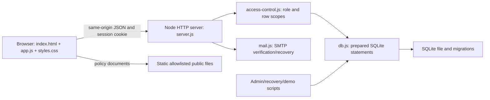

# RETURNO system design

Reviewed: 2026-10-14. For current priorities and verified test counts, use [PROJECT-ROADMAP.md](PROJECT-ROADMAP.md). This document describes the implemented architecture, not a production-readiness certification.

## Scope and roles

RETURNO is a single-campus lost-and-found prototype. Students create reports and browse/search the shared authenticated feed. They can view their own reports but cannot edit, change status, or delete reports. Administrators manage reports and return statuses, register admins, review account-deletion requests, and delete other accounts after confirmation. Student claim submission, My claims, and proof-of-ownership APIs are excluded by product decision.

## Runtime architecture

There is one Node process and one SQLite connection. The frontend has no compilation step. `public/app.js` owns hash-based views, events, forms, and in-memory UI state. `public/api.js` centralizes same-origin requests, JSON handling, and connection errors. `server.js` currently owns routing, request validation, authentication, SQL access, static serving, and response security headers. The single-file UI and HTTP handler are still small-project boundaries, but are large enough that future approved work should be split along view/route and domain responsibilities rather than added as unrelated code paths.

## Navigation

The app uses hash routes and the History API. Normal navigation pushes history; selected post-editor transitions replace their entry to avoid returning to a cancelled/submitted editor. Feed, own posts, search, admin dashboard/profile, login, registration, recovery, and About use the SPA. Terms and Privacy are separate public HTML documents; their query parameters preserve the role label, display name, and requested return route. The role query parameter changes only displayed links and never grants API access. The policy Back path preserves About and the original dashboard destination for both roles; the student/admin round trip is covered by Playwright.

## Authentication and authorization

- Passwords use salted Node `scrypt`; verification uses constant-time comparison.
- Sessions use random bearer tokens. Only SHA-256 token hashes are stored in SQLite; the browser receives an `HttpOnly`, `SameSite=Strict` cookie with a seven-day expiry. `Secure` is enabled when `COOKIE_SECURE=true`.
- Public student registration stores a pending verification record and does not create an account/session until the emailed six-digit code succeeds. Codes expire after ten minutes, allow five attempts, and are throttled. Admin-created accounts do not use this student signup verification flow.
- Student recovery uses an emailed single-use code and revokes all sessions after a successful password change. Admin recovery is a local CLI operation.
- Non-read API requests check request Origin and cross-site fetch metadata when present. Login/registration/recovery attempts are throttled per source IP in process memory.
- `access-control.js` uses deny-by-default route permissions. `server.js` derives identity from the authenticated session, rechecks authorization after streamed request bodies, and applies SQL predicates for protected rows.
- SQLite row controls are **application-enforced**, not native RLS. Filesystem/database access is outside the web permission boundary. Registration's Terms/Privacy checkbox is client-enforced and acceptance is not versioned in the database.

## Data model and migrations

`users`, `sessions`, and `posts` are the core tables. Foreign keys cascade account deletion to posts and sessions. Additional migrations hold pending signup challenges, password-reset challenges, public contact fields, account-deletion requests, and the retired student-claim records retained for migration compatibility. The retired claim table has no current student API/UI.

Migrations are numbered and immutable. Startup checks a checksum ledger and applies the next migration batch in one transaction with foreign keys enabled. A mismatch or newer database history prevents startup instead of silently rewriting data. `schema.sql` is a reference for the original schema; startup uses `migrations/`.

Post reads are paginated by the UI at 28 rows (API limit 100). Search/status/ownership filters share the count and row scopes. For compatibility, API requests without pagination parameters can still return all matching rows. Post JSON currently includes base64 image data. Admin user search loads all registered accounts and has no server pagination.

## Security and operational boundaries

Parameterized SQL is used for user-supplied values. Dynamic SQL fragments are fixed allowlisted clauses. API projections exclude password hashes and session tokens. Public static serving is allowlisted by file type and denies the local originals directory. Security headers include CSP, `X-Frame-Options: DENY`, `nosniff`, and same-origin referrer policy.

Images accept PNG/JPEG/WebP with a 10 MB decoded-byte limit and magic-byte checks. Full image decoding and dimension/pixel limits are not implemented. Image bytes in paginated JSON can produce large responses; separate image delivery is a scaling task.

The API runs HTTP and expects HTTPS to be terminated by a hosting layer. The default host is loopback. `COOKIE_SECURE=true`, persistent SQLite storage, proxy-aware rate limiting, monitoring, backups, and restore procedures must be configured and verified before public hosting. The current in-memory per-process rate limiter does not replace an edge-level abuse control. SQLite calls and `scryptSync` execute synchronously, which can block the event loop under heavier workloads. No restore test, load test, or production deployment check is claimed.

## Verification

The automated suite uses isolated temporary databases and covers HTTP/API flows, role boundaries, SQL injection attempts, migrations, account deletion, verification/recovery, CLI setup, client state, and navigation. Playwright uses isolated servers/databases across desktop, mobile, narrow-phone, and tablet Chromium projects. The seven-size responsive audit runs once in the desktop project; the three other project copies are intentionally skipped. Current results and known test limits are recorded in the roadmap. Physical-device, Safari/WebKit, full accessibility, live SMTP, load, backup restoration, and production checks remain outstanding.
